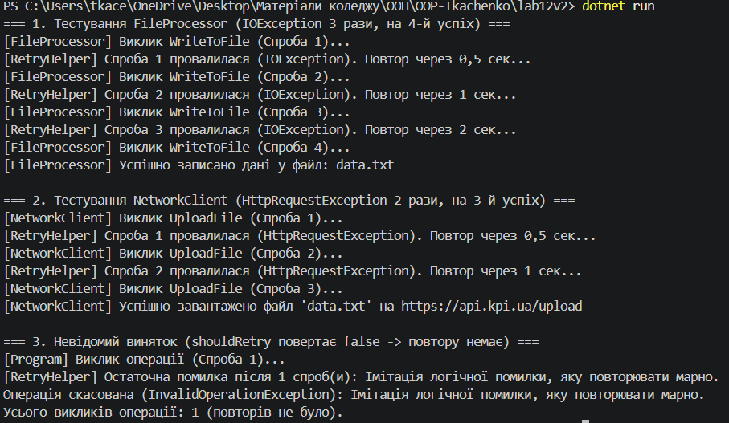

# Звіт з лабораторної роботи №12

**З дисципліни:** Об'єктно-орієнтоване програмування  
**Тема:** Обробка I/O/мережевих помилок та патерн Retry.  
**Виконав:** студент Ткаченко Максим **Варіант:** №2

---

## 1. Мета роботи

Навчитися обробляти типові помилки вводу/виводу та мережеві помилки за допомогою блоків `try-catch-finally`, а також реалізувати патерн `Retry` для підвищення відмовостійкості застосунків.

---

## 2. Індивідуальне завдання (Варіант 2)

**Сценарій:** Запис у файл та вивантаження по мережі.  
Реалізувати класи `FileProcessor` та `NetworkClient`, а також узагальнений допоміжний клас `RetryHelper`.

* **Метод `FileProcessor.WriteToFile`:** імітує `IOException` перші 3 рази, потім успіх.
* **Метод `NetworkClient.UploadFile`:** імітує `HttpRequestException` перші 2 рази, потім успіх.
* **Клас `RetryHelper`:** узагальнений метод `ExecuteWithRetry<T>` з експоненційною затримкою між повторами та делегатом `shouldRetry`.
* **Делегат `shouldRetry`:** повторює операції лише для `IOException` та `HttpRequestException`.

---

## 3. Структура проєкту

```text
OOP-Tkachenko/
├── .gitignore
├── README.md
├── result.png
└── lab12v2/
    ├── Lab12v2.csproj
    ├── Program.cs
    ├── RetryHelper.cs
    ├── FileProcessor.cs
    └── NetworkClient.cs
```

* `lab12v2/FileProcessor.cs` — клас, що імітує запис у файл із тимчасовими збоями (`IOException`).
* `lab12v2/NetworkClient.cs` — клас, що імітує мережеві запити з тимчасовими збоями (`HttpRequestException`).
* `lab12v2/RetryHelper.cs` — статичний узагальнений клас із патерном `Retry`, експоненційною затримкою та вибірковою обробкою винятків.
* `lab12v2/Program.cs` — точка входу `Main` із трьома сценаріями: запис у файл, вивантаження по мережі та невідомий виняток без повторів.
* `.gitignore` — виключення системних та тимчасових файлів .NET.

---

## 4. Запуск

```text
cd OOP-Tkachenko/lab12v2
dotnet run
```

---

## 5. Результати виконання програми

```text
=== 1. Тестування FileProcessor (IOException 3 рази, на 4-й успіх) ===
[FileProcessor] Виклик WriteToFile (Спроба 1)...
[RetryHelper] Спроба 1 провалилася (IOException). Повтор через 0,5 сек...
[FileProcessor] Виклик WriteToFile (Спроба 2)...
[RetryHelper] Спроба 2 провалилася (IOException). Повтор через 1 сек...
[FileProcessor] Виклик WriteToFile (Спроба 3)...
[RetryHelper] Спроба 3 провалилася (IOException). Повтор через 2 сек...
[FileProcessor] Виклик WriteToFile (Спроба 4)...
[FileProcessor] Успішно записано дані у файл: data.txt

=== 2. Тестування NetworkClient (HttpRequestException 2 рази, на 3-й успіх) ===
[NetworkClient] Виклик UploadFile (Спроба 1)...
[RetryHelper] Спроба 1 провалилася (HttpRequestException). Повтор через 0,5 сек...
[NetworkClient] Виклик UploadFile (Спроба 2)...
[RetryHelper] Спроба 2 провалилася (HttpRequestException). Повтор через 1 сек...
[NetworkClient] Виклик UploadFile (Спроба 3)...
[NetworkClient] Успішно завантажено файл 'data.txt' на https://api.kpi.ua/upload

=== 3. Невідомий виняток (shouldRetry повертає false -> повтору немає) ===
[Program] Виклик операції (Спроба 1)...
[RetryHelper] Остаточна помилка після 1 спроб(и): Імітація логічної помилки, яку повторювати марно.
Операція скасована (InvalidOperationException): Імітація логічної помилки, яку повторювати марно.
Усього викликів операції: 1 (повторів не було).
```

### Скріншот виконання програми



---

## 6. Висновок

Експоненційна затримка у патерні Retry забезпечує поступове збільшення часу очікування між спробами (0,5с, потім 1с, потім 2с). Це дозволяє уникнути перевантаження ресурсів системи під час тимчасових збоїв. Патерн успішно застосовано для вирішення проблем блокування файлу (`IOException`) та тимчасової недоступності мережі (`HttpRequestException`). Делегат `shouldRetry` дозволяє гнучко налаштовувати, які саме винятки варто повторювати: для невідомого винятку (`InvalidOperationException`) повтору не відбувається, і помилка одразу передається далі.
